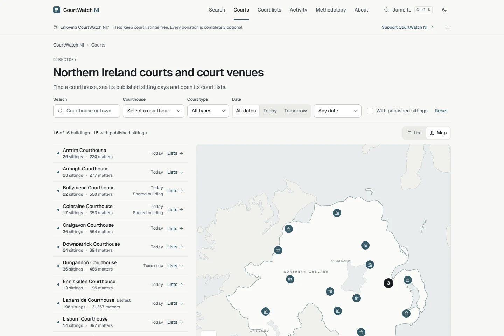
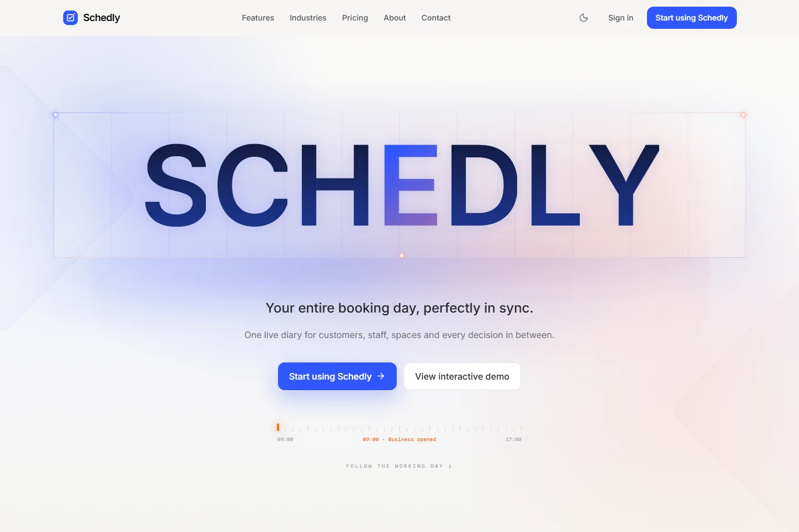
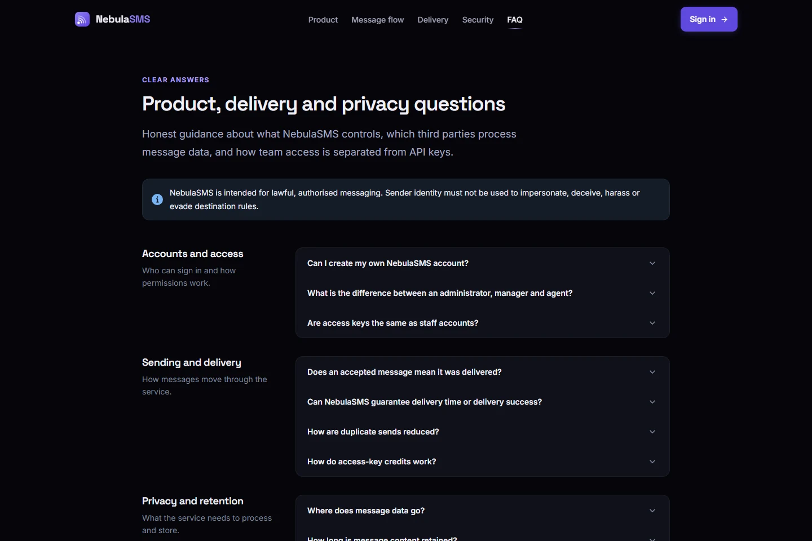
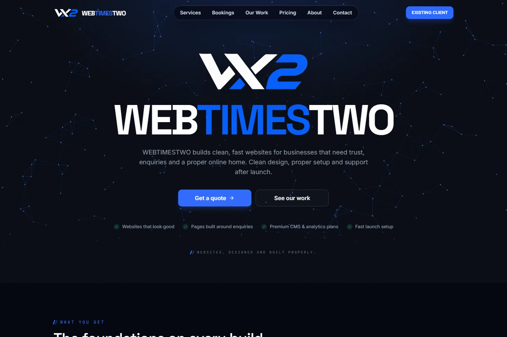
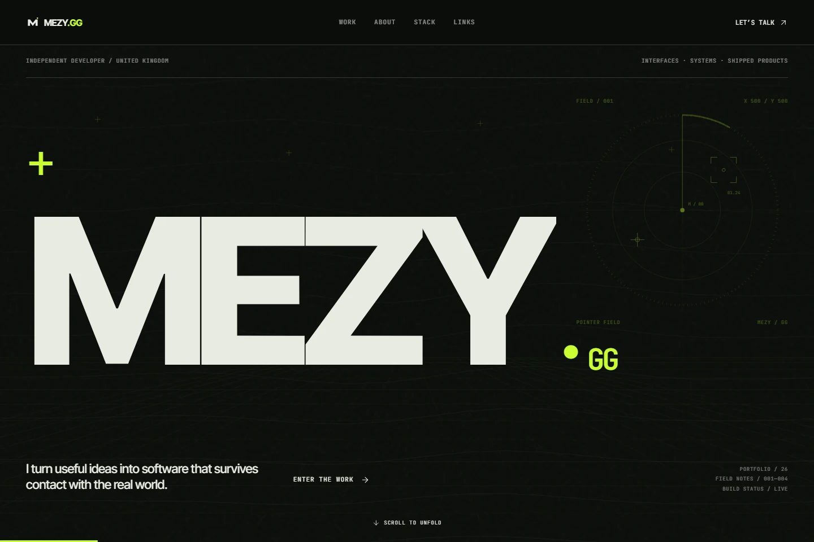

# mezy

**Full-stack developer building web applications, SaaS products and practical developer tools.**

Based in the United Kingdom. Founder of [WebTimesTwo](https://webtimestwo.com).

[Portfolio](https://mezy.gg) · [Web studio](https://webtimestwo.com) · [Get in touch](mailto:josh@webtimestwo.com)

I build the interface, connect the APIs and databases, and take the application through deployment.
My work spans public information, business bookings and communications, with a focus on clear interfaces and reliable backend behaviour.

## Featured projects

### 01 · CourtWatch NI

**The project:** An independent platform that makes Northern Ireland's published court listings easier to navigate.

**The solution:** Search current listings, browse court dates and courthouse information, and explore an interactive map and aggregate activity dashboard.

**Engineering:** A scheduled Node.js collector feeds a PostgreSQL-backed API and React interface. Source publication limits and suppression rules guide what is available.

**Technologies:** React · TypeScript · Node.js · PostgreSQL · Cloudflare

[Explore CourtWatch NI](https://courtwatchni.co.uk) · [Courthouse map](https://courtwatchni.co.uk/courts) · [Activity](https://courtwatchni.co.uk/dashboard)

Independent project. Not affiliated with NICTS or the Department of Justice. The preview shows courthouse locations and aggregate counts, without participant names.

### 02 · Schedly

**The project:** Scheduling and customer management for small businesses that book staff, rooms, tables or other resources.

**The solution:** Bring the resource diary, customer booking pages, availability and customer records into one product.

**Engineering:** A multi-tenant Supabase backend, database-backed conflict checks and transactional booking flows. Stripe Connect deposit flows are implemented; platform enrolment is still pending.

**Technologies:** React · TypeScript · Vite · Supabase · Stripe Connect

[Explore Schedly](https://schedly.pro)

### 03 · NebulaSMS

**The project:** An invite-only communications platform for teams managing SMS operations.

**The solution:** Compose, authorise and track message requests, with access controls, credit accounting and delivery history.

**Engineering:** Supabase authentication, server-side role checks and a Vonage provider adapter. Provider acceptance and delivery reports are recorded as distinct states.

**Technologies:** React · TypeScript · Express · Supabase · Vonage

[Explore NebulaSMS](https://nebulasms.com) · [Public product guide](https://nebulasms.com/faq)

The preview is the public FAQ. Private workspaces, recipients and message contents are excluded.

### 04 · WebTimesTwo

**The project:** My web development studio for businesses that need a clear, useful online presence.

**The solution:** Responsive websites, hosting, launch setup and ongoing care, with CMS-backed content where appropriate.

**Engineering:** Reusable React layouts, mobile-first interfaces and integration with a shared CMS. I run the studio and develop its sites; Toby Black built the underlying CMS platform.

**Technologies:** React · TypeScript · Vite · Tailwind CSS · Framer Motion

[Explore WebTimesTwo](https://webtimestwo.com) · [Client example: Masala Monsoon](https://masalamonsoonni.co.uk)

### 05 · mezy.gg

**The project:** My personal portfolio and the home of my developer identity.

**The solution:** A single place to explore my work, technical decisions and contact details.

**Engineering:** A custom canvas field, scroll-led project stories and a motion system that accommodates reduced-motion preferences.

**Technologies:** React · JavaScript · Vite · Tailwind CSS · Framer Motion

[Explore mezy.gg](https://mezy.gg)

All previews are genuine captures of public pages, taken 26 October 2026. Live websites may change.

## Technical skills

- **Frontend:** React, TypeScript, JavaScript, HTML, CSS, Tailwind CSS
- **Backend & data:** Node.js, Express, PostgreSQL, Supabase
- **Infrastructure:** Cloudflare, nginx, GitHub Actions
- **Integrations:** Stripe Connect, Vonage
- **Quality & tooling:** Vite, Vitest, Playwright, Node.js test runner

## Open source

### [route-contract](https://github.com/joshwebtimestwo/route-contract)

Dependency-free HTTP smoke tests for status codes, redirects and response headers.
Portable JSON contracts, GET/HEAD support and deterministic local fixtures make it useful for checking a deployment.

### [repo-checks](https://github.com/joshwebtimestwo/repo-checks)

A read-only GitHub API CLI that reports checks and commit statuses for an exact commit SHA.
Handles pagination, timeouts and rate limits, and treats missing checks as a separate outcome.

Both tools have documentation, automated tests and CI on Node.js 22/24 across Linux and Windows.
I value small, useful projects with tests that exercise real behaviour.

## Contact

Explore [mezy.gg](https://mezy.gg), visit [WebTimesTwo](https://webtimestwo.com), or email [josh@webtimestwo.com](mailto:josh@webtimestwo.com) about a website, product or collaboration.
